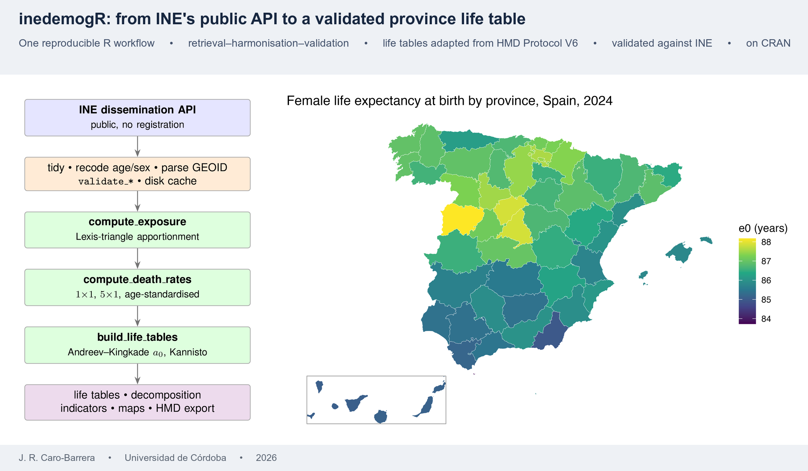
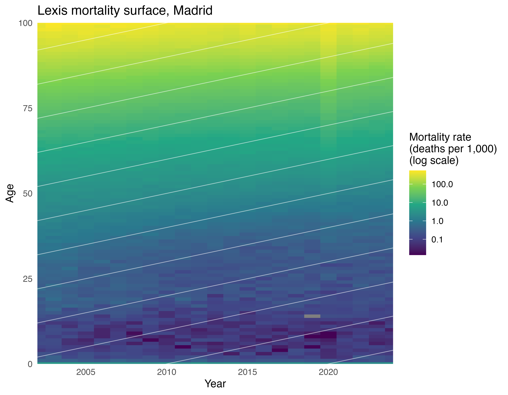
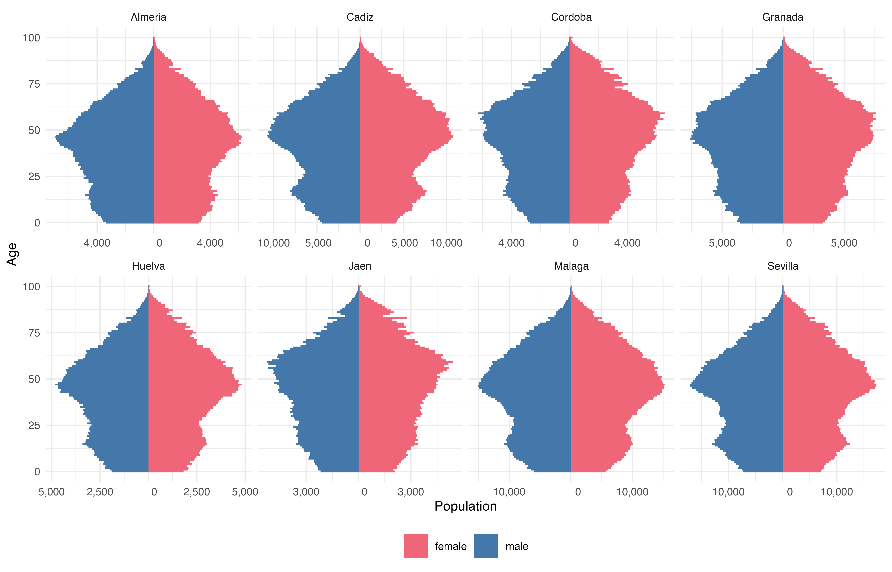

 &emsp;  &emsp; 

## Important links

- University of Córdoba's official repository
[{width="150"}](http://hdl.handle.net/10396/37577){target="_blank"}


## Abstract

`inedemogR` is an R package that turns the Spanish National Statistics Institute (INE) demographic data into tidy,
analysis-ready tables. A quick-lookup interface returns population, birth and death totals by geography and year.
A second interface builds province-level exposures, death rates and single-year period life tables following the
Human Mortality Database protocol (Version 6), adapted where INE’s data require it: deaths are split evenly
between Lexis triangles and old-age mortality is fitted at ages 80–99. Single-year life tables are supported from
2002. In 3588 province–sex–year comparisons for 2002–2024, made separately for life expectancy at birth and
at age 65, the package agrees with INE’s published provincial tables to within 0.25 years in approximately 99%
of cases.

## Graphical Abstract




## Lexis Map




## Population Pyramids




## Citation

<p class="buttons" style="text-align:center;">
<a class="btn btn-danger" target="_blank" href="https://www.zotero.org/save?type=doi&q=10.1016/j.softx.2026.103189">&emsp;Add to Zotero </a>
</p>

```bibtex
@article{CAROBARRERA2026103189,
title = {inedemogR: Reproducible retrieval and life-table computation for Spanish subnational demographic data},
journal = {SoftwareX},
volume = {36},
pages = {103189},
year = {2026},
issn = {2352-7110},
doi = {https://doi.org/10.1016/j.softx.2026.103189},
url = {https://www.sciencedirect.com/science/article/pii/S2352711026006795},
author = {J.R. Caro-Barrera},
keywords = {Demography, Mortality, Life-tables, Spain, Official-statistics, Reproducibility, R},
abstract = {inedemogR is an R package that turns the Spanish National Statistics Institute (INE) demographic data into tidy, analysis-ready tables. A quick-lookup interface returns population, birth and death totals by geography and year. A second interface builds province-level exposures, death rates and single-year period life tables following the Human Mortality Database protocol (Version 6), adapted where INE’s data require it: deaths are split evenly between Lexis triangles and old-age mortality is fitted at ages 80–99. Single-year life tables are supported from 2002. In 3588 province–sex–year comparisons for 2002–2024, made separately for life expectancy at birth and at age 65, the package agrees with INE’s published provincial tables to within 0.25 years in approximately 99% of cases.}
}
```


